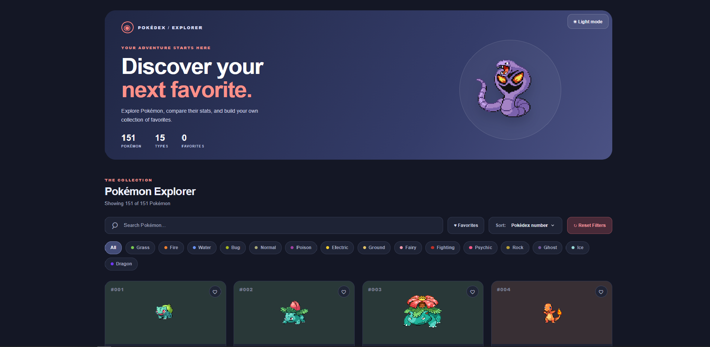

# Pokémon Explorer

An interactive Pokémon exploration and data visualization web application built with React, D3.js, and Vite.

<p align="center">
  <a href="https://fabienhaury.github.io/react-foundation/">
    
  </a>
</p>

<p align="center">
  <a href="https://fabienhaury.github.io/react-foundation/"><strong>🚀 Live Demo</strong></a>
  ·
  <a href="https://github.com/FabienHaury/react-foundation"><strong>📂 Source Code</strong></a>
</p>

## Overview

Pokémon Explorer is a web application dedicated to exploring the Pokémon universe through an interactive, data-driven interface.

Built with React and D3.js, the project combines modern frontend development with data visualization techniques to create an engaging way to explore Pokémon-related information.

## Tech Stack

- **[React](https://react.dev/)** — Building interactive user interfaces with reusable components.
- **[D3.js](https://d3js.org/)** — Data manipulation and visualization.
- **[Vite](https://vite.dev/)** — Fast development server and optimized production builds.
- **[ESLint](https://eslint.org/)** — Code quality and consistency checks.
- **[GitHub Pages](https://pages.github.com/)** — Hosting and deployment.

## Getting Started

### Prerequisites

- [Node.js](https://nodejs.org/)
- npm, included with Node.js

### Installation

Clone the repository:

```bash
git clone https://github.com/FabienHaury/react-foundation.git
cd react-foundation
npm install
```

### Run Locally

Start the development server:

```bash
npm run dev
```

Open the local URL displayed in your terminal to access the application.

## Available Scripts

| Command | Description |
|---|---|
| `npm run dev` | Starts the development server. |
| `npm run build` | Builds the application for production. |
| `npm run preview` | Previews the production build locally. |
| `npm run lint` | Runs ESLint checks. |
| `npm run deploy` | Builds and deploys the application to GitHub Pages. |

## Project Structure

```text
react-foundation/
├── public/
├── src/
├── Screenshoots/
│   └── website_preview.png
├── index.html
├── package.json
├── package-lock.json
├── vite.config.js
└── eslint.config.js
```

## Production Build

Create an optimized production build:

```bash
npm run build
```

Preview the production build locally:

```bash
npm run preview
```

## Deployment

The application is deployed using GitHub Pages.

To publish an updated version, run:

```bash
npm run deploy
```

Make sure GitHub Pages is configured correctly in the repository settings and that the Vite base path matches the repository name.

**Live website:** [Pokémon Explorer](https://fabienhaury.github.io/react-foundation/)

## Project Goals

- Explore modern React development and component-based architecture.
- Experiment with D3.js and data visualization.
- Build interactive, data-driven web interfaces.
- Practice modern frontend tooling and development workflows.
- Deploy a web application using GitHub Pages.

## Contributing

Suggestions, improvements, and contributions are welcome.

1. Fork the repository.
2. Create a feature branch:

   ```bash
   git checkout -b feature/your-feature
   ```

3. Make your changes.
4. Run the linter:

   ```bash
   npm run lint
   ```

5. Verify the production build:

   ```bash
   npm run build
   ```

6. Commit your changes and open a pull request.

## License

No license is currently specified in the repository. Check the repository for licensing terms before reusing or redistributing the code.

---

Developed by [Fabien Haury](https://github.com/FabienHaury).
